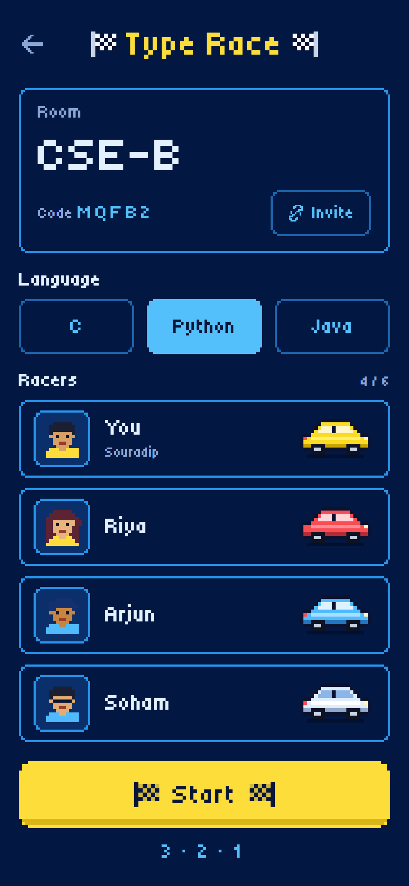
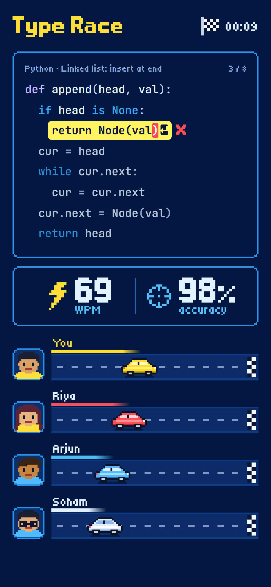
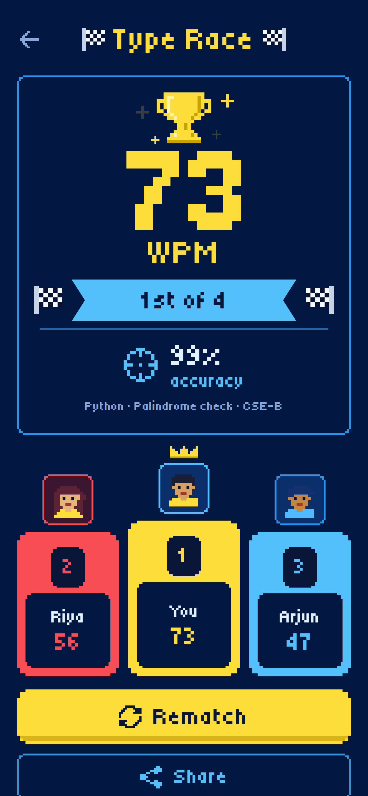

# Type Race

**Don't brag about your typing speed. Prove it.** Race your classmates live, typing real code (C, Python or Java) instead of English sentences. Share a room link in the class group, everyone's car lines up, 3-2-1, and the podium settles who actually types fastest.

**Play it:** https://souradip121.github.io/type-race/
**Or host your own copy for free** in four steps (below). No build step, no server, no sign-in.

<p>
  
  
  
</p>

Made by [@souradip.sh](https://www.instagram.com/souradip.sh/).

---

## How it works

1. **Make a room.** Type your name and a room name (your class, like `CSE-B`), pick C, Python or Java. You get a link with a 5-character code. Send it to your friends.
2. **Friends join from the link.** They type their name once; up to 6 racers per room, each with their own car colour. Tap your face in the lobby to change your avatar.
3. **Anyone presses Start.** Everyone gets the same snippet (4 to 8 lines: binary search, bubble sort, linked-list insert, palindrome check...) after a 3-2-1 countdown.
4. **Type it.** Your car moves with what you've typed correctly; everyone else's cars move live. A wrong character turns red and blocks you until you delete it.
5. **Podium.** Placings come from the server, so every phone shows the same podium. **Rematch** pulls the whole room into a new race with a new snippet; **Share** makes a story-size result card.

Alone in a room? **Practise solo** runs the same race against a pace car, then against your own best (kept on your phone).

### Typing rules

- **WPM = characters typed ÷ 5, per minute.** "Characters typed" means every character of the snippet except indentation, and each Enter counts as one character. That's the standard 5-characters-per-word definition, applied to code.
- **Indentation is typed for you.** Each line starts at its code, not at its leading spaces. If you type spaces or Tab at the start of a line anyway, they're ignored.
- **One line at a time, Enter to go to the next.** Pressing Enter early is a mistake like any other.
- **Accuracy** = keystrokes that were right when you typed them ÷ all keystrokes. Fixing a mistake doesn't undo it.
- **Phone keyboards:** the typing box turns off auto-capitalise, autocorrect, spellcheck and suggestions. Whatever slips through is normalised: curly quotes become `'` and `"`, `—` becomes `--` (so `i--` works on iPhone), `…` becomes `...`, full-width and non-breaking characters become plain ASCII, and a capital the keyboard added at the start of a line is forgiven when the code has the lowercase letter. Pasting is blocked.

### Why the scores are fair

- The **server starts the race** (`starts_at` is set in the database, 4.5 s ahead, and every phone counts down to the same moment using the server's clock).
- When you finish, the **server times you**: it accepts your phone's own measured time only within 2 seconds of its own clock (to forgive network lag), computes your WPM from the snippet's length, and **refuses anything above 250 WPM**. A refused finish isn't recorded.
- Placings are ranked in the database, so two phones can't disagree about who won.
- Live car positions travel over a Realtime broadcast channel. They're only for show; nothing on that channel counts toward a result.

### Security and privacy

- No accounts. Each browser makes a random player token and keeps it in `localStorage`; the database stores only its SHA-256.
- **Row Level Security** is on for every table, with no policies, and the public API roles have no table privileges. The browser can only call the `tr_*` functions in [`schema.sql`](schema.sql) (`SECURITY DEFINER`, `search_path` pinned), which check the room code and the player token.
- What's stored: room name and code, the language, each racer's name, avatar and car, and race results. **Rooms and everything in them are deleted 24 hours after the room was made** (an hourly `pg_cron` job; expired rooms stop working immediately even before the job runs).
- Only the Supabase **anon key** is in `config.js`. It's meant to be public. Never put the `service_role` key in this repo.

---

## Host your own copy (free, 4 steps)

You need a free [Supabase](https://supabase.com) account and a GitHub account (or Netlify / Vercel).

1. **Create a Supabase project.** supabase.com → New project. Pick a region close to your college (Mumbai `ap-south-1` for most of India).
2. **Run the schema.** In the project, open **SQL Editor → New query**, paste the whole of [`schema.sql`](schema.sql) and press **Run**. It creates five tables (all prefixed `tr_`), their lock-down, the race functions and the 40 snippets. It's safe to run again, and safe in a project that already has other tables.
   - To have expired rooms deleted automatically, turn on **pg_cron** first (**Database → Extensions → pg_cron**), then run the schema. Without it, expired rooms still stop working; they just stay in the table until you delete them (`delete from public.tr_rooms where expires_at < now();`).
3. **Put your keys in `config.js`.** Fork this repo, then edit [`config.js`](config.js): set `supabaseUrl` and `supabaseAnonKey` from **Project Settings → API** (Project URL, and the `anon` `public` key).
4. **Publish the site.**
   - **GitHub Pages:** in your fork, **Settings → Pages → Build and deployment → Deploy from a branch → `main` / `(root)`**. Your site appears at `https://<you>.github.io/type-race/`.
   - **Netlify / Vercel:** import the repo. There's no build command; the publish directory is the repo root.

That's it: there's no sign-in to configure and nothing to switch on for Realtime (public Broadcast channels work out of the box). Open your site on two phones and race.

### Add or change snippets

Snippets live in [`assets/js/snippets.js`](assets/js/snippets.js). The database keeps a copy, because the server needs each snippet's length to time races. After editing:

```bash
node scripts/snippets-sql.mjs
```

That rewrites the snippet block at the bottom of `schema.sql`; run that block (or the whole file) in the SQL editor again. `npm test` checks every snippet is 4 to 8 lines, fits a phone screen, and that the app and the database count its length the same way.

### Free-tier notes

- **Projects pause after about a week with no activity.** Open the Supabase dashboard and press **Restore project**; do a test race the day before you want to use it with a class.
- **Realtime:** every racer holds one Realtime connection and sends a few progress messages a second while typing. A class of 60 racing in rooms of 6 is well inside the free plan; check Supabase's current Realtime limits for anything much bigger.
- **Size:** a race result is a few dozen bytes and rooms are deleted after a day, so the free 500 MB database never fills up.

---

## Running it locally

Plain HTML, CSS and JavaScript modules. No build step and nothing to install:

```bash
python -m http.server 8799
```

then open http://localhost:8799.

Checks (Node 20+):

| Command | What it does |
|---|---|
| `npm test` | snippet rules and the typing engine (normalisation, indentation, blocking mistakes, accuracy, WPM) |
| `node scripts/live-check.mjs` | 51 checks against your Supabase project: tables locked, every function's refusals, server timing, the 250 WPM cap, identical placings, room limits, Realtime broadcast |
| `node tools/e2e.mjs` | two headless Chrome browsers race each other through the real UI and must agree on the podium (needs Chrome) |
| `node tools/bots.mjs CODE "Riya:1:58" ...` | adds test racers to a room: they drive their cars over Realtime at a set WPM and finish through the real server checks |

The checks name their test rooms `lc …` and `e2e …`; delete them afterwards with `delete from public.tr_rooms where name like 'lc %' or name like 'e2e %';` (or let them expire).

## Files

```
index.html            the whole app (home, lobby, race, results, solo)
config.js             your Supabase URL + anon key (the only file you edit)
schema.sql            tables, lock-down, race functions, expiry job, snippets (all tr_*)
assets/js/
  app.js              screens and room logic
  engine.js           the typing engine
  snippets.js         the 40 snippets
  sprites.js          pixel art (cars, avatars, trophy, frames) drawn as SVG
  net.js              Supabase calls, server clock, Realtime channel
  share.js            the result card image
assets/css/           styles
assets/fonts/         Tiny5, JetBrains Mono
vendor/               supabase-js (see vendor/LICENSES.md)
scripts/, tests/, tools/   checks and test tools
```

## Licence

MIT. Fonts are SIL OFL; supabase-js is MIT ([vendor/LICENSES.md](vendor/LICENSES.md)). All pixel art was drawn for this app.
